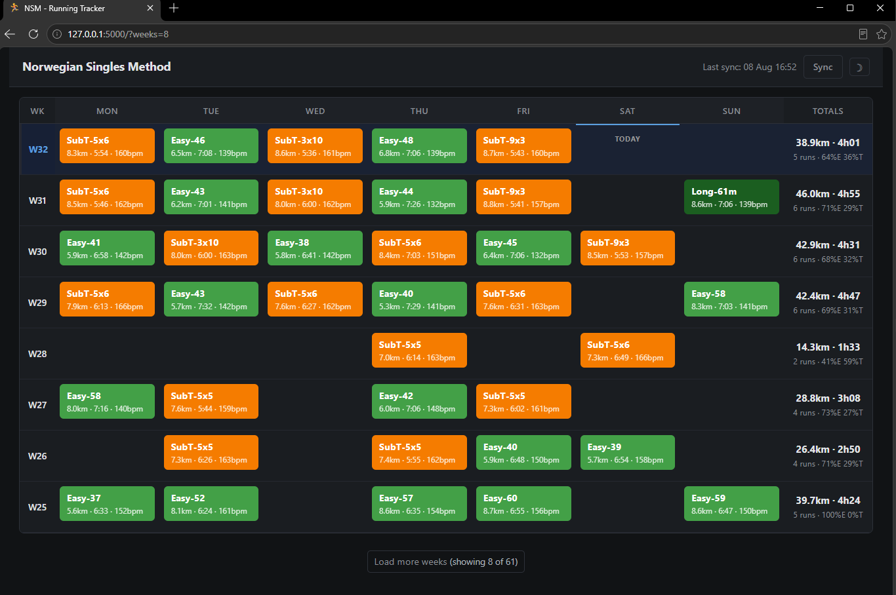

# NSM - Norwegian Singles Method Running Tracker

A minimal, self-maintaining local web application that replaces an Excel spreadsheet for tracking the Norwegian Singles running program.

The app syncs automatically with [Intervals.icu](https://intervals.icu), classifies workouts, and displays a weekly training grid.



Built with Claude Opus 4.6.

## Quick Start

### Docker (recommended)

```bash
cp config.example.json config.json   # Edit with your API key
docker compose up -d
```

### Without Docker

```bash
pip install -r requirements.txt
cp config.example.json config.json   # Edit with your API key
python app.py
```

Open [http://localhost:5000](http://localhost:5000) in your browser.

On the first run, the app performs an initial sync. This can take a few minutes because it fetches interval data for each activity.

## Configuration

Edit `config.json`:

| Field | Description | Default |
| --- | --- | --- |
| `api_key` | Your Intervals.icu API key, found under Settings → Developer | Required |
| `athlete_id` | Athlete ID — `0` resolves to the API key owner | `"0"` |
| `activity_types` | Activity types to include | `["Run", "TrailRun", "VirtualRun"]` |
| `weeks_initial_sync` | Number of weeks of history to fetch on the first run | `12` (3 months) |
| `port` | Local server port | `5000` |
| `db_path` | SQLite database file path | `"data/nsm.db"` |
| `debug` | Enable verbose logging for activity counts, filters, and sync details | `false` |

## How It Works

### Architecture

```text
Intervals.icu API
        │
        ▼
  sync.py (Python, requests)
        │
        ▼
  SQLite (nsm.db)
        │
        ▼
  app.py (Flask, 2 routes)
        │
        ▼
  index.html (Bootstrap 5 CDN, Jinja2, minimal JavaScript)
```

**Dependencies:** `flask` and `requests`.

### Sync Algorithm

- **Initial sync:** Downloads all activities from the configured history period. For each run, it fetches interval data from the API to determine the workout classification.
- **Incremental refresh:** Fetches activities from `last_sync - 2 days` through the current time. The overlap helps catch edits to recent activities.
- **Upserts:** Existing activities are updated by activity ID, while new activities are inserted.
- **Deleted activities:** The sync detects and removes activities that no longer exist in the configured date range.
- **Rate limiting:** Waits 100 ms between interval-data requests.

### Workout Classification

Each activity is automatically classified using its Intervals.icu interval data:

| Classification | Rule | Display name |
| --- | --- | --- |
| **Interval** | Has one or more `WORK` intervals | `SubT-{count}x{avg_minutes}` |
| **Long** | Has no intervals and duration is at least 60 minutes | `Long-{minutes}m` |
| **Easy** | All other activities | `Easy-{minutes}` |

### Training Distribution

Weekly totals show an E/T split:

- **T (Threshold):** Total seconds spent in `WORK` intervals.
- **E (Easy):** Total moving time minus T time. Warm-up, cool-down, and recovery intervals all count as Easy.

## Project Structure

```text
NSM/
├── app.py              # Flask server and main entry point
├── sync.py             # Intervals.icu synchronization logic
├── classify.py         # Workout classification algorithm
├── config.json         # Local settings (gitignored)
├── config.example.json # Configuration template
├── schema.sql          # Database schema
├── requirements.txt    # Python dependencies
├── Dockerfile
├── docker-compose.yml
├── .gitignore
├── .dockerignore
├── templates/
│   └── index.html      # UI template (Jinja2 + Bootstrap 5)
├── static/
│   └── style.css       # Custom styles
└── data/
    └── nsm.db          # SQLite database (auto-created, gitignored)
```

## Contributing

This is a personal tool shared publicly. Contributions are welcome, with realistic expectations:

- **Bugs** - Addressed based on severity and personal availability
- **Pull requests** - Please open an issue first to discuss it before submitting a pull request.
- **Feature requests** - May not align with my needs. Fork and customize as needed.