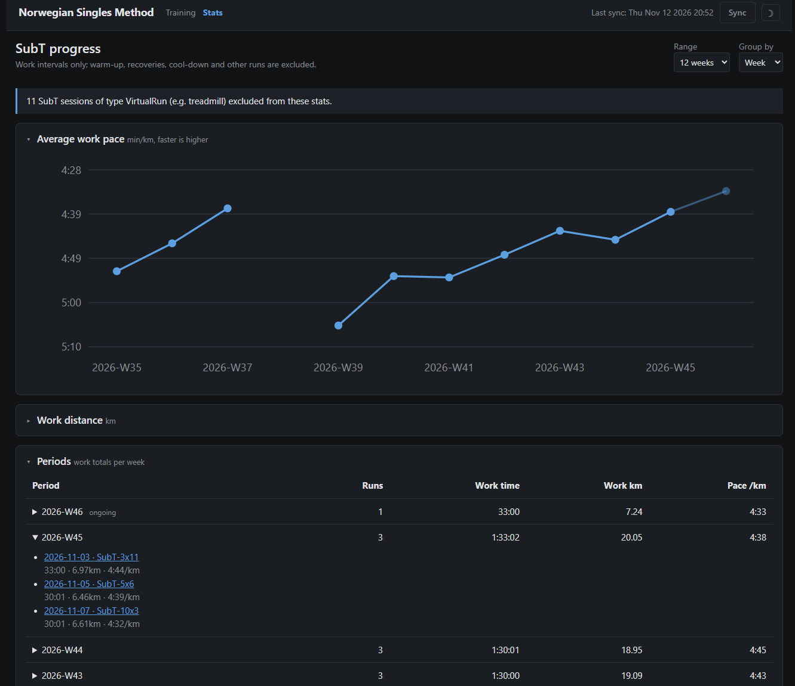

# NSM - Norwegian Singles Method Running Tracker

A minimal, self-maintaining local web application that replaces an Excel spreadsheet for tracking the Norwegian Singles running program.

The app syncs automatically with [Intervals.icu](https://intervals.icu), classifies workouts, and displays a weekly training grid. A **Stats** page charts your SubT progress: work-interval pace and distance per week or month.




Built with Claude Opus 4.6.

## Quick Start

### Docker (recommended)

Run these commands from the project directory:

```bash
cp config.example.json config.json   # Edit with your API key
docker compose up -d
```

### Corporate network / TLS-inspecting proxy

If sync fails with `SSLCertVerificationError` behind a corporate TLS-inspecting proxy, add the CA certificate(s) to `certs/` as PEM-encoded `.crt` files, one certificate per file. Set ENV-variable `NSM_DOCKERFILE=Dockerfile.custom-ca` and rebuild and restart the container. Certificates in `certs/` are gitignored; TLS certificate and hostname verification remain enabled.

### Without Docker

```bash
pip install -r requirements.txt
cp config.example.json config.json   # Edit with your API key
python app.py
```

Open [http://localhost:5000](http://localhost:5000) in your browser.

On the first run, the app performs an initial sync. This can take a few minutes because it fetches interval data for each activity.

When upgrading from a version without the Stats page, the database is migrated automatically. The next sync (automatic when the data is stale, or press **Sync**) fills in the work-interval data for the interval sessions you already have stored.

## Configuration

Edit `config.json`:

| Field | Description | Default |
| --- | --- | --- |
| `api_key` | Your Intervals.icu API key, found under Settings → Developer | Required |
| `athlete_id` | Athlete ID — `0` resolves to the API key owner | `"0"` |
| `activity_types` | Activity types to include | `["Run", "TrailRun", "VirtualRun"]` |
| `weeks_initial_sync` | Number of weeks of history to fetch on the first run | `12` (3 months) |
| `sync_stale_minutes` | Auto-refresh when the page is opened and the last sync is older than this | `60` |
| `port` | Local server port | `5000` |
| `db_path` | SQLite database file path | `"data/nsm.db"` |
| `debug` | Enable verbose logging for activity counts, filters, and sync details | `false` |

## How It Works

### Units & Locale

Distance, pace, timezone, and date/time display are automatically fetched from your Intervals.icu profile on every sync.

### Architecture

```text
Intervals.icu API
        │
        ▼
  sync.py (Python, requests)
        │
        ▼
  SQLite (nsm.db)
        │
        ▼
  app.py (Flask, 3 routes)
        │
        ▼
  index.html / stats.html (Bootstrap 5 CDN, Jinja2, minimal JavaScript, inline SVG charts)
```

**Dependencies:** `flask` and `requests`.

### Sync Algorithm

- **Initial sync:** Downloads all activities from the configured history period. For each run, it fetches interval data from the API to determine the workout classification.
- **Incremental refresh:** Fetches activities from `last_sync - 2 days` through the current time. The overlap helps catch edits to recent activities.
- **Auto-refresh on visit:** When you open the dashboard, it renders instantly from the local database, then refreshes in the background only if the last sync is older than `sync_stale_minutes`. A tab left open re-checks on the same interval, so it stays current without a manual reload. You can always force a refresh with the **Sync** button. 
- **Upserts:** Existing activities are updated by activity ID, while new activities are inserted.
- **Deleted activities:** The sync detects and removes activities that no longer exist in the configured date range.
- **Rate limiting:** Waits 100 ms between interval-data requests.
- **Work-interval backfill:** Every sync also fills in the work-only distance for stored interval sessions that lack it, including sessions older than the incremental window. These are classified again from their current Intervals.icu data, progress is saved every 25 sessions, and sessions that fail are retried on the next sync. History that was never stored locally is not downloaded.
- **Interval fetch failures:** If interval data cannot be fetched for an activity, it is skipped and reported in the sync errors. An existing stored activity keeps its previous values, and a new one is picked up by a later sync (the 2-day overlap). It is not stored as an easy run.

### Workout Classification

Each activity is automatically classified using its Intervals.icu interval data:

| Classification | Rule | Display name |
| --- | --- | --- |
| **Race** | Activity `sub_type` is `RACE` — takes priority over all rules below | `Race` |
| **Interval** | Has a recovery of at least 15 seconds and an interval group with at least two repetitions | `SubT-{count}x{avg_minutes}` |
| **Long** | Not an interval session and moving time is at least 60 minutes | `Long-{minutes}` |
| **Easy** | All other activities | `Easy-{minutes}` |

### Training Distribution

Weekly totals show an E/T split:

- **T (Threshold):** Total seconds spent in the repeated `WORK` intervals of interval sessions.
- **E (Easy):** Total moving time minus T time. Warm-up, cool-down, and recovery intervals all count as Easy.

### SubT Stats

Open **Stats** in the header (`/stats`). It reads only from the local database.

- **What is counted:** Only the repeated `WORK` intervals of interval sessions. Warm-up, recoveries, cool-down, races, easy runs and long runs are excluded; all interval formats (3x10, 5x6, ...) are combined.
- **Pace:** Total work time divided by total work distance. It is never an average of session or weekly paces, so a longer set weighs more. It is rounded to the nearest second.
- **Charts:** Work pace (line, faster is higher) and work distance (bars) per week or month, with a table underneath. Expand a period to see its sessions.
- **Range and grouping:** The last 12, 26 or 52 weeks, or all stored history, grouped by ISO week or calendar month (monthly view starts at the month containing the range start).
- **Gaps:** A period without SubT shows zero work and no pace. The current period is faded. If an interval session has no work data yet, its period shows an *incomplete* badge, known totals only, and is left out of the charts until a sync fills it in.
- Charts are inline SVG generated on the server, so there are no extra dependencies.

## Project Structure

```text
NSM/
├── app.py              # Flask server and main entry point
├── sync.py             # Intervals.icu synchronization logic
├── classify.py         # Workout classification and work-interval totals
├── stats.py            # SubT stats aggregation and chart geometry
├── formatting.py       # Unit, date/time, duration and pace formatting
├── config.json         # Local settings (gitignored)
├── config.example.json # Configuration template
├── schema.sql          # Database schema
├── requirements.txt    # Python dependencies
├── Dockerfile          # Regular image (default)
├── Dockerfile.enterprise # Corporate proxy CA support
├── docker-compose.yml
├── .gitignore
├── .dockerignore
├── certs/              # Local corporate CA certificates (gitignored)
│   └── .gitkeep
├── templates/
│   ├── base.html       # Shared header, navigation and sync script
│   ├── index.html      # Weekly training grid
│   ├── stats.html      # SubT stats page
│   └── chart.html      # SVG chart partial
├── static/
│   └── style.css       # Custom styles
├── tests/
│   └── test_stats.py   # Unit tests (python -m unittest)
└── data/
    └── nsm.db          # SQLite database (auto-created, gitignored)
```

## Contributing

This is a personal tool shared publicly. Contributions are welcome, with realistic expectations:

- **Bugs** - Addressed based on severity and personal availability
- **Pull requests** - Please open an issue first to discuss it before submitting a pull request.
- **Feature requests** - May not align with my needs. Fork and customize as needed.